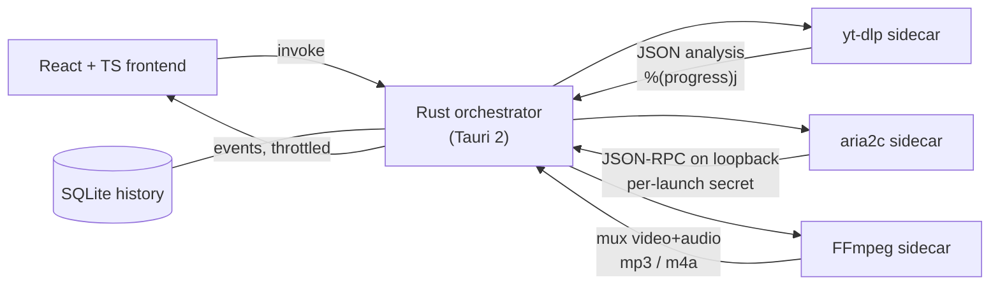

  <picture>
    <source media="(prefers-color-scheme: dark)" srcset=".github/assets/banner-dark.svg">
    
  </picture>

  
<strong>Download files, torrents &amp; videos. Preview before you download.</strong>

  [🇬🇧 English](README.md) • [🇷🇺 Русский](README.ru.md)

---

## Contents

- [Why Gruzly](#-why-gruzly)
- [Screenshots](#-screenshots)
- [Installation](#-installation)
- [Quick start](#-quick-start)
- [Video preview](#-video-preview)
- [Queue and history](#-queue-and-history)
- [Settings and updates](#-settings-and-updates)
- [Architecture](#-architecture)
- [Keyboard shortcuts](#%EF%B8%8F-keyboard-shortcuts)
- [Roadmap](#-roadmap)
- [Contributing](#-contributing)
- [Legal](#%EF%B8%8F-legal)
- [Acknowledgements](#-acknowledgements)
- [License](#-license)

## ✨ Why Gruzly

- **Video preview first.** Gruzly analyzes a link and shows the title, metadata
  and a format summary — quality, codec, container, estimated size, HDR — before
  you commit bandwidth.
- **Files and torrents in one place.** HTTP, HTTPS, FTP, magnet links and local
  `.torrent` files land in the same queue. aria2 can use up to 16 connections
  per file when the server supports ranges, and torrents ask you which files to
  download.
- **A queue that explains itself.** Every row shows the bytes moved, rate and
  time remaining when the engine can report them. Torrent rows distinguish
  metadata, file selection, waiting for a slot, waiting for peers and seeding.
- **Real engines, small shell.** yt-dlp, aria2 and FFmpeg do the work; the
  Rust/Tauri shell validates arguments and stays out of the way.
- **Both themes, both languages.** Dark, light and system themes with accent and
  density settings; English and Russian are complete, with plural forms handled
  by `Intl`.

## 📸 Screenshots

| Dark | Light |
|---|---|
|  |  |
|  |  |

## 🚀 Installation

Choose the package for your system on the
[latest release page](https://github.com/Therealwh/gruzly/releases/latest).
The Windows installers and portable archive include yt-dlp, aria2 and FFmpeg.

| Package | System |
|---|---|
| `Gruzly_<ver>_x64-setup.exe` | Windows 10/11 x64, NSIS installer |
| `Gruzly_<ver>_x64_en-US.msi` | Windows 10/11 x64, MSI installer |
| `Gruzly-portable-win64.zip` | Windows x64 — extract and run `Gruzly.exe` |
| `Gruzly_<ver>_amd64.deb` | Linux x86-64 — `sudo apt install ./Gruzly_<ver>_amd64.deb` |
| `Gruzly_<ver>_amd64.AppImage` | Linux x86-64 — make the file executable, then run it |
| `Gruzly_aarch64.app.tar.gz` | Apple Silicon macOS — extract the `.app` |

- **Windows.** The NSIS and MSI installers can download WebView2 during setup.
  The portable ZIP expects WebView2 to be installed already. History, settings
  and engine data live in your user profile, outside the extracted folder.
- **Linux.** The `.deb` declares dependencies on `aria2` and
  `libwebkit2gtk-4.1-0`. For the AppImage, install `aria2` from your
  distribution; some systems also need FUSE.
- **macOS.** The build uses Homebrew's `aria2` and FFmpeg and may need their
  libraries at runtime. Tauri update signatures and Apple notarization are
  separate concerns.

Sidecar versions and hashes are pinned in `engines.lock.json`; update them only
with a reviewed source change.

## ⚡ Quick start

1. **Video.** Open **Video**, paste a supported link and choose **Analyze**.
   Pick a preset in the preview and confirm the download.
2. **Direct files.** Open **Files & Torrents**, paste a link and choose **Add**.
   You can also submit several links at once. Quick add on the Dashboard fills
   the link into the matching section for you.
3. **Torrents.** Paste a magnet link, or choose or drop a local `.torrent` file.
   Wait for metadata, tick the files you want and confirm. If you dismiss the
   picker, reopen it from the queue. A remote `.torrent` URL goes through the
   direct-link flow instead.
4. **Downloads.** Follow live progress in the queue and use `⋯` for actions on
   any row. On completed rows, a double-click or double-tap opens the same menu.

## 🎬 Video preview

The preview modal shows the video's metadata and a format summary with
estimated sizes and HDR badges where available. An embedded player appears for
sites Gruzly can embed (YouTube, Rutube, OK, VK, Bilibili); for other links it
falls back to the thumbnail and metadata.

Choose **Best**, up to 1080p, up to 720p or **Audio only**, select available
subtitles, and pick individual videos in supported playlists. Extraction is
done by yt-dlp, so which links work also depends on the site and on yt-dlp's
current extractors.

## 📋 Queue and history

- **Downloads.** Counted **Active**, **Queued**, **Completed** and **Errors**
  tabs, plus search and a type filter. Active and queued jobs can be reordered
  with the drag handle or from the keyboard. The footer shows total download
  and upload rates and how many parallel slots are in use.
- **Torrent details.** Select a row to see its phase (metadata, file selection,
  waiting for a slot or peers, seeding), selected files and total size,
  destination, and connections with connected seeders when aria2 reports them.
  Details open in a side panel on wide windows and in a dialog on narrow ones.
- **Actions.** Pause, resume, cancel and retry appear in the states where they
  apply. Retrying a local torrent asks for the original `.torrent` and accepts
  only a matching info hash; a previously confirmed selection is reused when
  the file indices still match. **Copy details** shares a summary that omits
  links, local paths and secrets.
- **Completed downloads.** Grouped into Video, Files and Torrents. Each row can
  reveal its output in the folder or play a finished video in the system player.
- **History.** A local SQLite database records every download from the moment
  it is added. Search, filter by status and type, sort, re-check files and
  export to CSV. Unfinished video jobs come back paused after a restart; direct
  file and torrent jobs have to be added again.

## ⚙️ Settings and updates

- Download folder, parallel jobs, speed limit and seeding ratio, plus proxy
  (HTTP or SOCKS5), notifications, tray behaviour, autostart, cookies and
  yt-dlp auto-update. What each engine honours depends on the engine.
- For video downloads that need a sign-in, enable cookies in
  **Settings → Integrations**. A `cookies.txt` file takes priority over browser
  extraction and is the more reliable option on Windows, where Chrome locks its
  cookie database. Treat that file as a login credential. Video analysis
  itself does not send cookies.
- **Presets** stores custom profiles. Applying them automatically by domain is
  not wired yet; the preview uses its built-in quality presets.
- **About** checks for signed app updates and verifies the update package
  signature. Portable builds update by extracting a newer ZIP.

## 🏗 Architecture

Engine arguments are validated in Rust and always passed as argv arrays — see
[SECURITY_REVIEW.md](SECURITY_REVIEW.md) for the full review.

## ⌨️ Keyboard shortcuts

| Shortcut | Action |
|---|---|
| `Ctrl+K` | Command palette |
| `Ctrl+V` | Open the Dashboard (only when focus is outside a text field) |
| `Ctrl+2` | Open Downloads |
| `Ctrl+3` | Open Video |
| `Ctrl+Shift+L` | Toggle light/dark theme |

These default bindings are remappable in **Settings → Hotkeys**. Shortcuts use
the Control key on every platform.

## 🗺 Roadmap

- [x] Video analysis → preview → download
- [x] Files and torrents via aria2 with per-file selection
- [x] Signed app updates
- [x] Tray menu, close-to-tray and autostart
- [x] Queue priorities (drag and keyboard)
- [x] Persistent history with search, filters and CSV export
- [x] Torrent phase tracking, details panel and retry
- [ ] Apply presets automatically by domain
- [ ] Restore file and torrent jobs after a restart
- [ ] Browser extension: catch video URLs mid-browse
- [ ] `gruzly <url>` CLI
- [ ] Phone remote: send a link from mobile

## 🤝 Contributing

PRs are welcome — see [CONTRIBUTING.md](CONTRIBUTING.md) for the gates and
conventions. Good first issues are labeled `good first issue`.

## ⚠️ Legal

Download only content you own or have permission to save. Gruzly does not
support, bypass or circumvent DRM or any copy-protection technology. Respect
copyright and the terms of service of the sites you use.

## 🙏 Acknowledgements

Gruzly is a thin shell around workhorse projects:

- [yt-dlp](https://github.com/yt-dlp/yt-dlp) — site extraction
- [aria2](https://github.com/aria2/aria2) — HTTP/FTP/torrent engine
- [FFmpeg](https://ffmpeg.org) — muxing and audio extraction
- [Tauri](https://v2.tauri.app) — the native shell
- [Radix UI](https://www.radix-ui.com) / [Tailwind CSS](https://tailwindcss.com) — UI primitives

## 📄 License

Gruzly's own code is [MIT](LICENSE). The bundled engines keep their own
licenses; versions, license terms and source links are listed in
[THIRD_PARTY_NOTICES.md](THIRD_PARTY_NOTICES.md).

## ⭐ Star History

