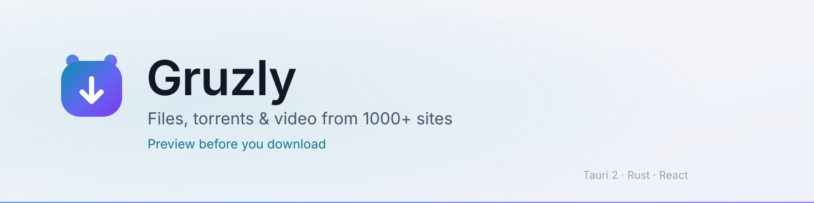
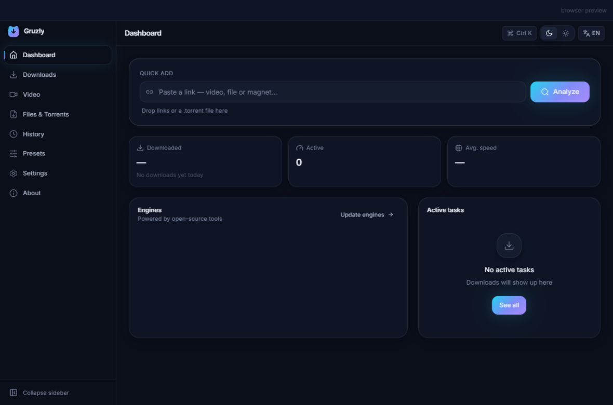
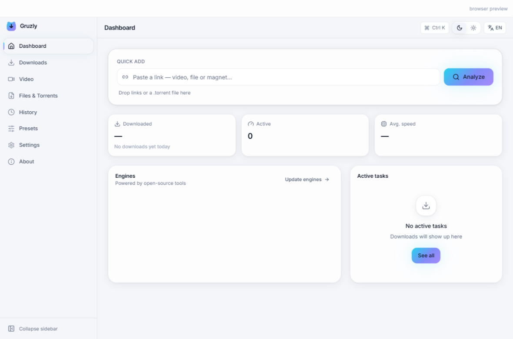
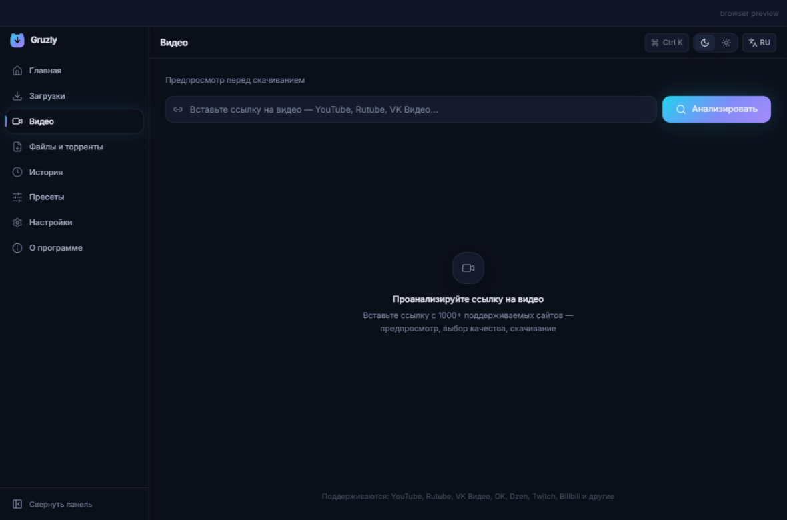
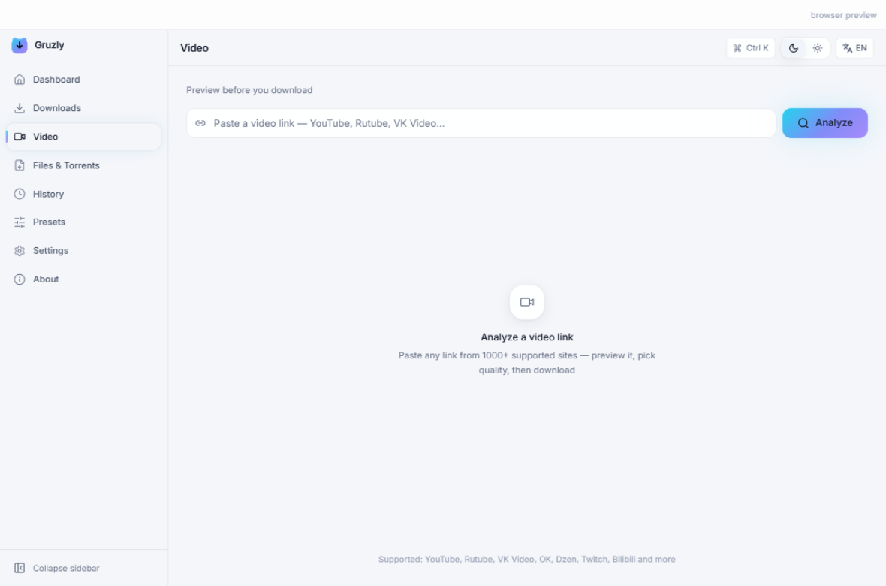
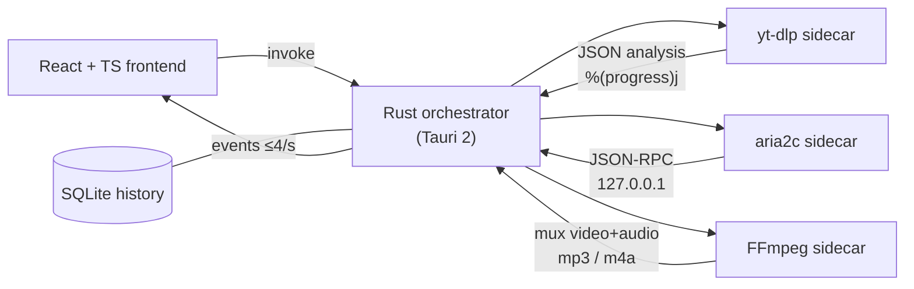

  <picture>
    <source media="(prefers-color-scheme: dark)" srcset=".github/assets/banner-dark.svg">
    
  </picture>

  
<strong>Files, torrents &amp; video from 1000+ sites. Preview before you download.</strong>

  [🇬🇧 English](README.md) • [🇷🇺 Русский](README.ru.md)

---

## Contents

- [What makes it different](#-what-makes-it-different)
- [Screenshots](#-screenshots)
- [Installation](#-installation)
- [Quick start](#-quick-start)
- [Video preview](#-video-preview)
- [How it compares](#-how-it-compares)
- [Architecture](#-architecture)
- [Keyboard shortcuts](#%EF%B8%8F-keyboard-shortcuts)
- [Roadmap](#-roadmap)
- [Contributing](#-contributing)
- [Legal](#%EF%B8%8F-legal)
- [Acknowledgements](#-acknowledgements)
- [License](#-license)

## ✨ What makes it different

- **See it before you spend the bandwidth.** Paste a link → an in-app player
  and a format table (quality, fps, codec, size, HDR) appear. Pick «Best»,
  «1080p», «720p» or «Audio only» — then commit.
- **One queue for everything.** Video, direct files, magnets and `.torrent`
  files live in the same list with live progress, pause/resume and retry.
- **Real engines, small shell.** yt-dlp, aria2 (16 connections per file) and
  FFmpeg do the heavy lifting; the Rust/Tauri shell stays out of the way.
- **Self-healing.** yt-dlp updates itself at launch — site extractors break
  regularly, the app keeps up.
- **Both themes, both languages.** Dark and light are designed, not inverted;
  English and Russian are complete, with pluralization handled by `Intl`.

## 📸 Screenshots

| Dark | Light |
|---|---|
|  |  |
|  |  |

## 🚀 Installation

Grab the latest build from
[Releases](https://github.com/Therealwh/gruzly/releases) — yt-dlp, aria2 and
FFmpeg are bundled, nothing else to install:

| File | What it is |
|---|---|
| `Gruzly_<ver>_x64-setup.exe` | Windows installer (NSIS) |
| `Gruzly_<ver>_x64_en-US.msi` | Windows MSI for silent deployment |
| `Gruzly-portable-win64.zip` | Portable — unzip anywhere, run `Gruzly.exe` |
| `Gruzly_<ver>_amd64.deb` / `.AppImage` | Linux (deb pulls `aria2` from repos) |
| `Gruzly_aarch64.app.tar.gz` | macOS (Apple Silicon) |

Windows 10+ includes WebView2 automatically. macOS/Linux builds come from CI.

## ⚡ Quick start

1. **Install and launch** — the app starts on the Dashboard.
2. **Paste any link** into Quick add — video links open the preview modal,
   files and magnets go straight to the queue.
3. **Pick quality, press Download** — progress, speed and ETA appear in the
   unified queue; right-click for open-folder / retry.

## 🎬 Video preview

The killer feature: analysis happens first, download happens after you
decide. The modal shows an embedded player (YouTube, Rutube, VK, OK,
Bilibili), the full format table with estimated sizes and HDR badges, one
click presets, subtitle selection, and playlist handling with per-video
checkboxes.

## 🆚 How it compares

| | Gruzly | IDM | JDownloader 2 | yt-dlp (CLI) | Browser |
|---|---|---|---|---|---|
| Price | Free, MIT | $25 lifetime | Free | Free | Free |
| Footprint | ~80 MB installed | ~15 MB | Java, heavy | CLI only | — |
| Torrents | ✓ | ✗ | ✓ | ✗ | ✗ |
| Video, 1000+ sites | ✓ | partial | ✓ | ✓ | ✗ |
| Preview before download | ✓ | ✗ | ✗ | ✗ | — |
| Multi-connection downloads | ✓ (16) | ✓ | ✓ | limited | ✗ |
| Dark & light themes | ✓ | ✗ | ✗ | — | — |
| RU & EN UI | ✓ | partial | ✓ | — | ✓ |

Where the others still win: IDM has two decades of browser-extension polish;
JDownloader's crawler covers more edge cases. Gruzly is young and moving fast.

## 🏗 Architecture

Engine arguments are validated in Rust and always passed as argv arrays —
see [SECURITY_REVIEW.md](SECURITY_REVIEW.md) for the full review.

## ⌨️ Keyboard shortcuts

| Shortcut | Action |
|---|---|
| `Ctrl+K` | Command palette |
| `Ctrl+V` | Paste & analyze link |
| `Ctrl+1…8` | Jump to section |
| `Ctrl+Shift+L` | Toggle theme |

All shortcuts are remappable in Settings → Hotkeys.

## 🗺 Roadmap

- [x] Video analysis → preview → download (v0.1.0)
- [x] Files & torrents via aria2 with per-file selection (v0.1.0)
- [x] Signed self-updates (v0.1.1)
- [x] Aria2 reliability fixes from field testing (v0.1.2)
- [ ] Tray menu & close-to-tray wiring
- [ ] Drag-and-drop queue priorities
- [ ] Per-domain preset auto-apply
- [ ] Browser extension: catch video URLs mid-browse
- [ ] `gruzly <url>` CLI
- [ ] Phone remote: send a link from mobile

## 🤝 Contributing

PRs are welcome — see [CONTRIBUTING.md](CONTRIBUTING.md) for the gates and
conventions. Good first issues are labeled `good first issue`.

## ⚠️ Legal

Download only content you own or have permission to save. Gruzly does not
support, bypass or circumvent DRM or any copy-protection technology. Respect
copyright and the terms of service of the sites you use.

## 🙏 Acknowledgements

Gruzly is a thin shell around workhorse projects:

- [yt-dlp](https://github.com/yt-dlp/yt-dlp) — site extraction
- [aria2](https://github.com/aria2/aria2) — HTTP/FTP/torrent engine
- [FFmpeg](https://ffmpeg.org) — muxing and audio extraction
- [Tauri](https://v2.tauri.app) — the native shell
- [Radix UI](https://www.radix-ui.com) / [Tailwind CSS](https://tailwindcss.com) — UI primitives

## 📄 License

[MIT](LICENSE). The bundled engines keep their own licenses (yt-dlp:
Unlicense, aria2: GPL-2.0, FFmpeg: LGPL-2.1+) and are distributed unmodified.

## ⭐ Star History

