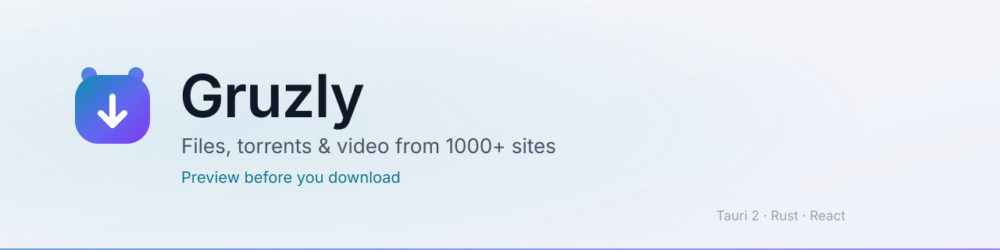
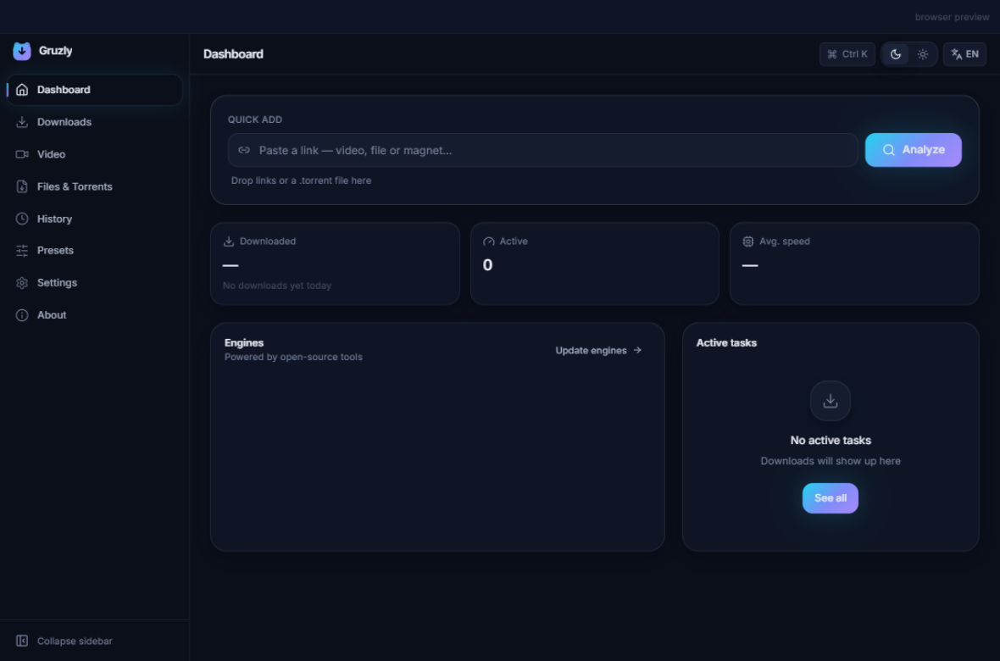
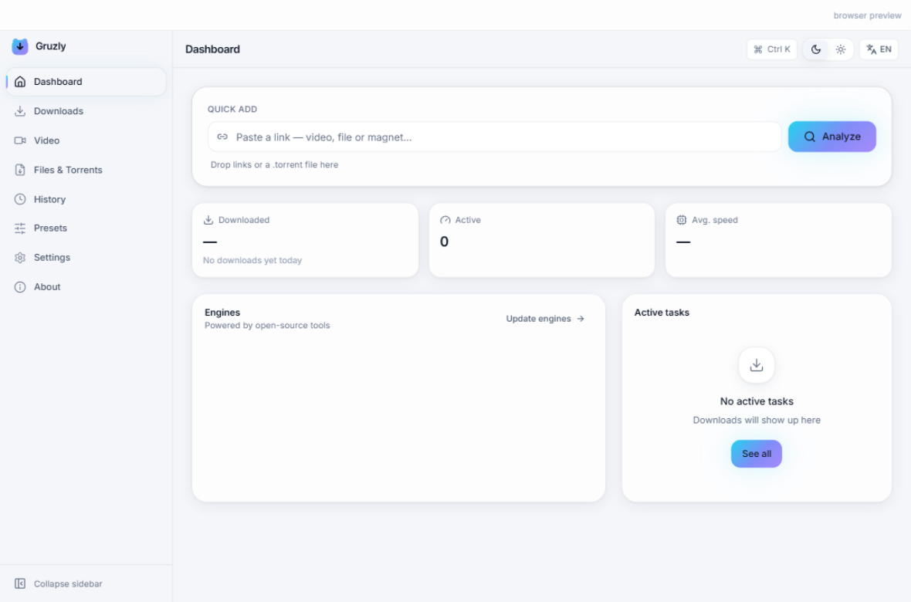
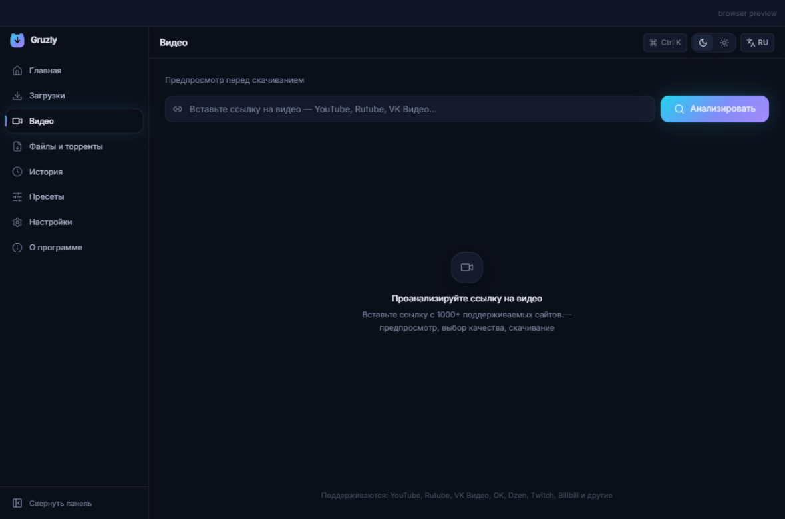
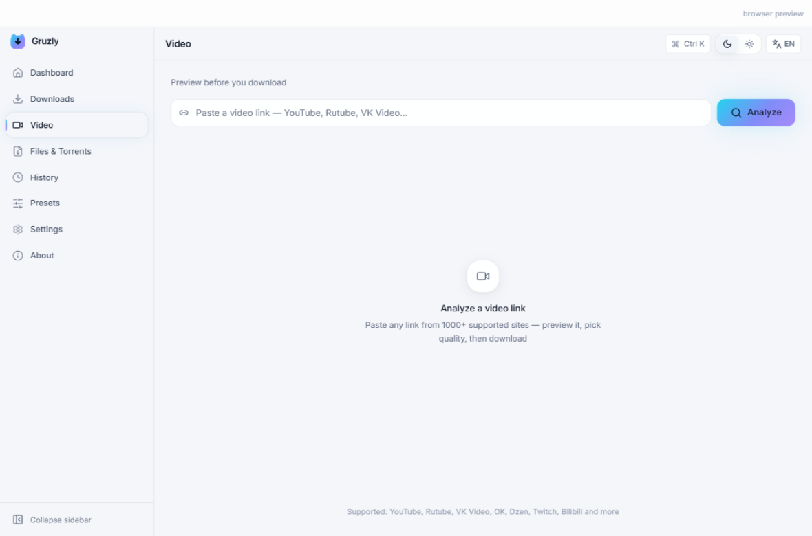
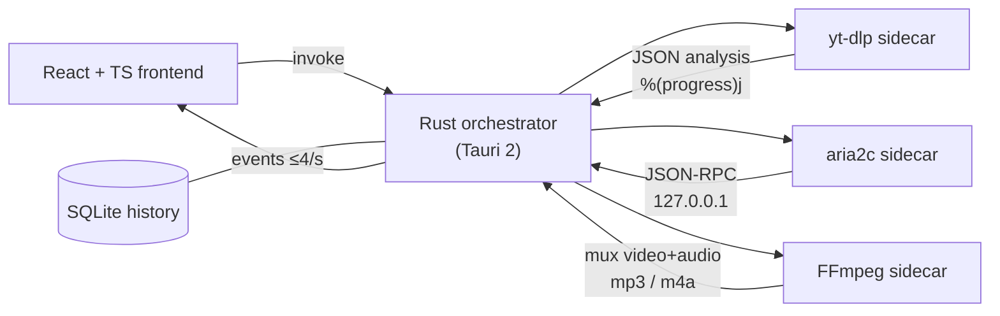

  <picture>
    <source media="(prefers-color-scheme: dark)" srcset=".github/assets/banner-dark.svg">
    
  </picture>

  
<strong>Файлы, торренты и видео с 1000+ сайтов. Предпросмотр перед скачиванием.</strong>

  [🇬🇧 English](README.md) • [🇷🇺 Русский](README.ru.md)

---

## Содержание

- [Чем отличается](#-чем-отличается)
- [Скриншоты](#-скриншоты)
- [Установка](#-установка)
- [Быстрый старт](#-быстрый-старт)
- [Предпросмотр видео](#-предпросмотр-видео)
- [Сравнение с другими](#-сравнение-с-другими)
- [Архитектура](#-архитектура)
- [Горячие клавиши](#%EF%B8%8F-горячие-клавиши)
- [План](#-план)
- [Участие](#-участие)
- [Правовая информация](#%EF%B8%8F-правовая-информация)
- [Благодарности](#-благодарности)
- [Лицензия](#-лицензия)

## ✨ Чем отличается

- **Посмотрите, прежде чем тратить трафик.** Вставьте ссылку → встроенный
  плеер и таблица форматов (качество, fps, кодек, размер, HDR). Выберите
  «Лучшее», «1080p», «720p» или «Только аудио» — и скачивайте.
- **Единая очередь для всего.** Видео, прямые файлы, magnet и `.torrent`
  живут в одном списке с живым прогрессом, паузой/продолжением и повтором.
- **Настоящие движки, тонкая оболочка.** yt-dlp, aria2 (до 16 соединений на
  файл) и FFmpeg делают тяжёлую работу; оболочка Rust/Tauri не мешает.
- **Самолечение.** yt-dlp обновляется при каждом запуске — экстракторы
  сайтов ломаются регулярно, приложение поспевает.
- **Обе темы, оба языка.** Тёмная и светлая спроектированы, а не «инвертированы»;
  русский и английский полные, плюрализация через `Intl`.

## 📸 Скриншоты

| Тёмная | Светлая |
|---|---|
|  |  |
|  |  |

## 🚀 Установка

Скачайте свежую сборку из
[Releases](https://github.com/Therealwh/gruzly/releases) — yt-dlp, aria2 и
FFmpeg уже внутри, ничего доустанавливать не нужно:

| Файл | Что это |
|---|---|
| `Gruzly_<ver>_x64-setup.exe` | Установщик Windows (NSIS) |
| `Gruzly_<ver>_x64_en-US.msi` | MSI для тихого развёртывания |
| `Gruzly-portable-win64.zip` | Portable — распаковать и запустить `Gruzly.exe` |
| `Gruzly_<ver>_amd64.deb` / `.AppImage` | Linux (deb ставит `aria2` из репозиториев) |
| `Gruzly_aarch64.app.tar.gz` | macOS (Apple Silicon) |

Windows 10+ получает WebView2 автоматически. macOS/Linux-сборки идут из CI.

## ⚡ Быстрый старт

1. **Установите и запустите** — приложение откроется на Главной.
2. **Вставьте любую ссылку** в быстрое поле — видео откроет предпросмотр,
   файлы и magnet уйдут прямо в очередь.
3. **Выберите качество и нажмите Скачать** — прогресс, скорость и ETA появятся
   в очереди; правый клик — открыть папку / повторить.

## 🎬 Предпросмотр видео

Киллер-фича: сначала анализ, скачивание — после вашего решения. В модальном
окне — встроенный плеер (YouTube, Rutube, VK, OK, Bilibili), полная таблица
форматов с примерными размерами и HDR-бейджами, пресеты в один клик, выбор
субтитров и плейлист с чекбоксами по роликам.

## 🆚 Сравнение с другими

| | Gruzly | IDM | JDownloader 2 | yt-dlp (CLI) | Браузер |
|---|---|---|---|---|---|
| Цена | Бесплатно, MIT | $25 навсегда | Бесплатно | Бесплатно | Бесплатно |
| Размер | ~80 МБ | ~15 МБ | Java, тяжёлый | только CLI | — |
| Торренты | ✓ | ✗ | ✓ | ✗ | ✗ |
| Видео, 1000+ сайтов | ✓ | частично | ✓ | ✓ | ✗ |
| Предпросмотр до скачивания | ✓ | ✗ | ✗ | ✗ | — |
| Многопоточная докачка | ✓ (16) | ✓ | ✓ | ограничено | ✗ |
| Тёмная и светлая темы | ✓ | ✗ | ✗ | — | — |
| Интерфейс RU и EN | ✓ | частично | ✓ | — | ✓ |

Где конкуренты всё ещё сильнее: у IDM двадцать лет доводки браузерных
расширений; краулер JDownloader покрывает больше исключительных случаев.
Gruzly молодой и быстро развивается.

## 🏗 Архитектура

Аргументы движков валидируются в Rust и всегда передаются массивами argv —
подробное ревью в [SECURITY_REVIEW.md](SECURITY_REVIEW.md).

## ⌨️ Горячие клавиши

| Сочетание | Действие |
|---|---|
| `Ctrl+K` | Палитра команд |
| `Ctrl+V` | Вставить и проанализировать ссылку |
| `Ctrl+1…8` | Перейти в раздел |
| `Ctrl+Shift+L` | Переключить тему |

Все сочетания переназначаются в Настройки → Горячие клавиши.

## 🗺 План

- [x] Анализ видео → предпросмотр → скачивание (v0.1.0)
- [x] Файлы и торренты через aria2 с выбором файлов раздачи (v0.1.0)
- [x] Подписанные само-обновления (v0.1.1)
- [x] Фиксы aria2 по результатам полевых тестов (v0.1.2)
- [ ] Меню трея и сворачивание в трей
- [ ] Приоритеты очереди drag-and-drop
- [ ] Авто-применение пресетов по домену
- [ ] Браузерное расширение: перехват ссылок на видео
- [ ] CLI `gruzly <url>`
- [ ] Пульт с телефона: отправь ссылку — скачается дома

## 🤝 Участие

PR приветствуется — гейты и конвенции в [CONTRIBUTING.md](CONTRIBUTING.md).
Хорошие первые задачи помечены `good first issue`.

## ⚠️ Правовая информация

Скачивайте только тот контент, права на который у вас есть. Gruzly не
поддерживает и не обходит DRM или иные технологии защиты копирайта. Уважайте
авторские права и правила сервисов.

## 🙏 Благодарности

Gruzly — тонкая оболочка над проверенными проектами:

- [yt-dlp](https://github.com/yt-dlp/yt-dlp) — извлечение с сайтов
- [aria2](https://github.com/aria2/aria2) — движок HTTP/FTP/торрентов
- [FFmpeg](https://ffmpeg.org) — склейка и извлечение аудио
- [Tauri](https://v2.tauri.app) — нативная оболочка
- [Radix UI](https://www.radix-ui.com) / [Tailwind CSS](https://tailwindcss.com) — UI-примитивы

## 📄 Лицензия

[MIT](LICENSE). Бандленные движки сохраняют свои лицензии (yt-dlp: Unlicense,
aria2: GPL-2.0, FFmpeg: LGPL-2.1+) и распространяются без изменений.

## ⭐ Star History

