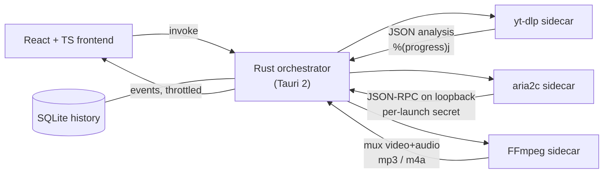

  <picture>
    <source media="(prefers-color-scheme: dark)" srcset=".github/assets/banner-dark.svg">
    
  </picture>

  
<strong>Скачивайте файлы, торренты и видео. Предпросмотр перед скачиванием.</strong>

  [🇬🇧 English](README.md) • [🇷🇺 Русский](README.ru.md)

---

## Содержание

- [Чем отличается](#-чем-отличается)
- [Скриншоты](#-скриншоты)
- [Установка](#-установка)
- [Быстрый старт](#-быстрый-старт)
- [Предпросмотр видео](#-предпросмотр-видео)
- [Очередь и история](#-очередь-и-история)
- [Браузер и командная строка](#-браузер-и-командная-строка)
- [Настройки и обновления](#%EF%B8%8F-настройки-и-обновления)
- [Архитектура](#-архитектура)
- [Горячие клавиши](#%EF%B8%8F-горячие-клавиши)
- [План](#-план)
- [Участие](#-участие)
- [Правовая информация](#%EF%B8%8F-правовая-информация)
- [Благодарности](#-благодарности)
- [Лицензия](#-лицензия)

## ✨ Чем отличается

- **Сначала предпросмотр видео.** Gruzly анализирует ссылку и показывает
  название, сведения о ролике и сводку форматов — качество, кодек,
  контейнер, примерный размер, HDR, — прежде чем вы потратите трафик.
- **Файлы и торренты в одном месте.** HTTP, HTTPS, FTP, magnet-ссылки и
  локальные `.torrent` попадают в одну очередь. aria2 использует до 16
  соединений на файл, если сервер поддерживает диапазоны, а для торрентов
  приложение спрашивает, какие файлы скачивать.
- **Очередь объясняет своё состояние.** В строке видны объём, скорость и
  оставшееся время, когда движок может их сообщить. Для торрентов различаются
  получение метаданных, выбор файлов, ожидание слота, ожидание пиров и раздача.
- **Настоящие движки, тонкая оболочка.** Работу делают yt-dlp, aria2 и FFmpeg;
  оболочка на Rust/Tauri проверяет аргументы и не мешает.
- **Обе темы, оба языка.** Тёмная, светлая и системная темы, настройки акцента
  и плотности; русский и английский переводы полные, формы множественного
  числа считает `Intl`.

## 📸 Скриншоты

| Тёмная | Светлая |
|---|---|
|  |  |
|  |  |

## 🚀 Установка

Выберите пакет для своей системы на странице
[последнего релиза](https://github.com/Therealwh/gruzly/releases/latest).
Установщики и portable-архив для Windows уже содержат yt-dlp, aria2 и FFmpeg.

| Пакет | Система |
|---|---|
| `Gruzly_<ver>_x64-setup.exe` | Windows 10/11 x64, установщик NSIS |
| `Gruzly_<ver>_x64_en-US.msi` | Windows 10/11 x64, установщик MSI |
| `Gruzly-portable-win64.zip` | Windows x64 — распакуйте и запустите `Gruzly.exe` |
| `Gruzly_<ver>_amd64.deb` | Linux x86-64 — `sudo apt install ./Gruzly_<ver>_amd64.deb` |
| `Gruzly_<ver>_amd64.AppImage` | Linux x86-64 — выдайте файлу право на запуск |
| `Gruzly_aarch64.app.tar.gz` | macOS на Apple Silicon — распакуйте `.app` |

- **Windows.** Установщики NSIS и MSI могут скачать WebView2 во время
  установки. Portable-архиву нужен уже установленный WebView2. История,
  настройки и данные движков хранятся в профиле пользователя, а не в папке
  с распакованным приложением.
- **Linux.** `.deb` объявляет зависимости от `aria2` и `libwebkit2gtk-4.1-0`.
  Для AppImage установите `aria2` из репозитория дистрибутива; на некоторых
  системах также нужен FUSE.
- **macOS.** Сборка использует `aria2` и FFmpeg из Homebrew и может требовать
  их библиотеки во время работы. Подпись автообновлений Tauri и нотаризация
  Apple — отдельные вопросы.

Версии и хэши sidecar закреплены в `engines.lock.json`; меняйте их только
вместе с проверенным источником.

## ⚡ Быстрый старт

1. **Видео.** Откройте **Видео**, вставьте поддерживаемую ссылку и нажмите
   **Анализировать**. Выберите вариант в предпросмотре и подтвердите загрузку.
2. **Прямые файлы.** Откройте **Файлы и торренты**, вставьте ссылку и нажмите
   **Добавить**. Можно отправить несколько ссылок сразу. Быстрое поле на
   главной само подставит ссылку в нужный раздел.
3. **Торренты.** Вставьте magnet-ссылку или выберите либо перетащите локальный
   `.torrent`. Дождитесь метаданных, отметьте нужные файлы и подтвердите. Если
   закрыть окно выбора, его можно снова открыть из очереди. URL удалённого
   `.torrent` обрабатывается как прямая ссылка.
4. **Загрузки.** Следите за передачей в очереди и открывайте действия кнопкой
   `⋯` в любой строке. У завершённой задачи то же меню открывается двойным
   щелчком или двойным касанием.

## 🎬 Предпросмотр видео

Модальное окно показывает сведения о ролике и сводку форматов с примерными
размерами и отметками HDR, когда эти данные доступны. Встроенный плеер
появляется для сайтов, которые Gruzly умеет встраивать (YouTube, Rutube, OK,
VK, Bilibili); для остальных ссылок остаются миниатюра и сведения о ролике.

Выберите **Лучшее**, до 1080p, до 720p или **Только аудио**, отметьте доступные
субтитры и нужные ролики в поддерживаемых плейлистах. Ссылки обрабатывает
yt-dlp, поэтому результат зависит и от сайта, и от актуальности его
экстракторов.

## 📋 Очередь и история

- **Загрузки.** Вкладки **Активные**, **Очередь**, **Завершённые** и **Ошибки**
  со счётчиками, плюс поиск и фильтр по типу. Активные и ожидающие задачи
  переставляются ручкой или с клавиатуры. Внизу — суммарные скорости
  скачивания и отдачи и число занятых слотов.
- **Подробности торрента.** В выбранной задаче видны этап (метаданные, выбор
  файлов, ожидание слота или пиров, раздача), выбранные файлы и их общий
  размер, папка, а также соединения и подключённые сиды, когда aria2 их
  сообщает. В широком окне подробности открываются справа, в узком — в диалоге.
- **Действия.** Пауза, продолжение, отмена и повтор показываются в подходящих
  состояниях. Для повтора локального торрента запрашивается исходный
  `.torrent`, принимается только совпадающий info-hash, а ранее подтверждённый
  выбор файлов используется снова, если индексы совпали. **Скопировать
  детали** даёт сводку без ссылок, локальных путей и секретов.
- **Завершённые.** Разделы «Видео», «Файлы» и «Торренты». Из строки можно
  открыть папку с результатом или воспроизвести готовое видео в системном
  проигрывателе.
- **Архивы.** Готовые ZIP, 7z, TAR, TAR.GZ и GZ можно распаковать из меню
  строки или панели подробностей в папку рядом с архивом. Для RAR нужен
  установленный 7-Zip. Записи, пытающиеся выйти за пределы папки распаковки,
  отклоняются, а сам архив никогда не удаляется.
- **История.** Локальная база SQLite записывает загрузку с момента добавления.
  Доступны поиск, фильтры по статусу и типу, сортировка, проверка файлов и
  экспорт в CSV. Незавершённые видео после перезапуска возвращаются на паузе;
  прямые файлы и торренты нужно добавить заново.

## 🌐 Браузер и командная строка

Gruzly регистрирует схему `gruzly://` при первом запуске — для пользователя в
Windows и Linux, из пакета приложения в macOS — поэтому ссылку можно передать
из браузера или скрипта.

- **Расширение для браузера.** Загрузите распакованное расширение из
  [`extension/`](extension/README.md) в Chrome или Edge. Появятся пункт
  контекстного меню и кнопка на панели, которые отправляют текущую страницу,
  ссылку или видео в Gruzly. Сборка для Firefox создаётся командой
  `node extension/package-firefox.mjs`.
- **Командная строка.** `gruzly "https://example.org/file.zip"` или
  `gruzly "magnet:?xt=..."` передаёт ссылку запущенному приложению; если Gruzly
  закрыт, он запустится и примет ссылку.
- **Что принимается.** Ссылки `http`, `https`, `ftp` и `magnet`. Адреса
  `file:`, `javascript:` и `data:` отклоняются.
- Страницы видео открываются в предпросмотре, файлы и magnet сразу попадают в
  очередь с выбранной папкой.

## ⚙️ Настройки и обновления

- Папка загрузки, число параллельных задач, ограничение скорости и коэффициент
  раздачи, а также прокси (HTTP или SOCKS5), уведомления, поведение трея,
  автозапуск, cookies и автообновление yt-dlp. Что именно учитывает каждый
  движок, зависит от движка.
- Для видео, требующего входа на сайт, включите cookies в
  **Настройки → Интеграции**. Файл `cookies.txt` имеет приоритет над чтением
  cookies из браузера и надёжнее на Windows, где Chrome блокирует свою базу
  cookies. Относитесь к этому файлу как к данным для входа. При анализе ссылки
  cookies не отправляются.
- **Пресеты** хранят пользовательские профили. Автоматическое применение по
  домену пока не подключено; в предпросмотре работают встроенные варианты
  качества.
- **Автораспаковка** распаковывает готовые архивы, если включена в
  **Настройки → Загрузки**.
- Раздел **О программе** проверяет подписанные обновления приложения и
  проверяет подпись пакета. Portable-сборка обновляется распаковкой нового ZIP.

## 🏗 Архитектура

Аргументы движков проверяются в Rust и всегда передаются массивами argv —
подробности в [SECURITY_REVIEW.md](SECURITY_REVIEW.md).

## ⌨️ Горячие клавиши

| Сочетание | Действие |
|---|---|
| `Ctrl+K` | Палитра команд |
| `Ctrl+V` | Открыть главную (только когда фокус не в поле ввода) |
| `Ctrl+2` | Открыть «Загрузки» |
| `Ctrl+3` | Открыть «Видео» |
| `Ctrl+Shift+L` | Переключить светлую/тёмную тему |

Эти сочетания переназначаются в **Настройки → Горячие клавиши**. На всех
платформах используется клавиша Control.

## 🗺 План

- [x] Анализ видео → предпросмотр → скачивание
- [x] Файлы и торренты через aria2 с выбором файлов раздачи
- [x] Подписанные обновления приложения
- [x] Меню трея, сворачивание в трей и автозапуск
- [x] Приоритеты очереди (мышью и с клавиатуры)
- [x] Постоянная история с поиском, фильтрами и экспортом в CSV
- [x] Этапы торрента, панель подробностей и повтор
- [x] Распаковка архивов: ZIP, 7z, TAR, GZ (RAR через системный 7-Zip)
- [ ] Автоматическое применение пресетов по домену
- [ ] Восстановление файловых и торрентных задач после перезапуска
- [x] Передача ссылок из браузера: `gruzly://` и локальное расширение
- [ ] Публикация расширения в магазинах браузеров
- [x] CLI `gruzly <url>`
- [ ] Пульт с телефона: отправьте ссылку — скачается дома

## 🤝 Участие

PR приветствуется — гейты и конвенции в [CONTRIBUTING.md](CONTRIBUTING.md).
Хорошие первые задачи помечены `good first issue`.

## ⚠️ Правовая информация

Скачивайте только тот контент, права на который у вас есть. Gruzly не
поддерживает и не обходит DRM или иные технологии защиты копирайта. Уважайте
авторские права и правила сервисов.

## 🙏 Благодарности

Gruzly — тонкая оболочка над проверенными проектами:

- [yt-dlp](https://github.com/yt-dlp/yt-dlp) — извлечение с сайтов
- [aria2](https://github.com/aria2/aria2) — движок HTTP/FTP/торрентов
- [FFmpeg](https://ffmpeg.org) — склейка и извлечение аудио
- [Tauri](https://v2.tauri.app) — нативная оболочка
- [Radix UI](https://www.radix-ui.com) / [Tailwind CSS](https://tailwindcss.com) — UI-примитивы

## 📄 Лицензия

Код Gruzly распространяется по лицензии [MIT](LICENSE). У встроенных движков
свои лицензии; версии, условия и ссылки на исходники перечислены в
[THIRD_PARTY_NOTICES.md](THIRD_PARTY_NOTICES.md).

## ⭐ Star History

